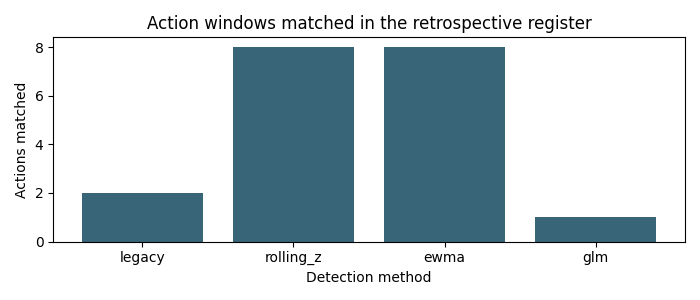
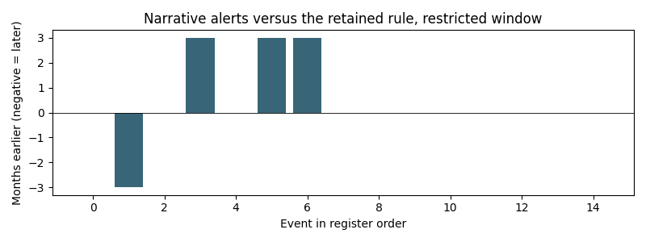
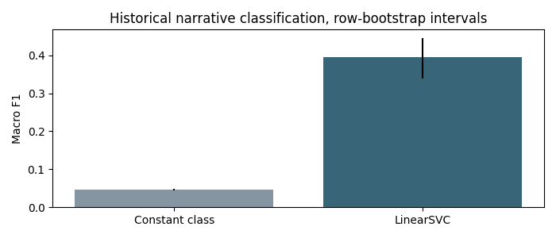
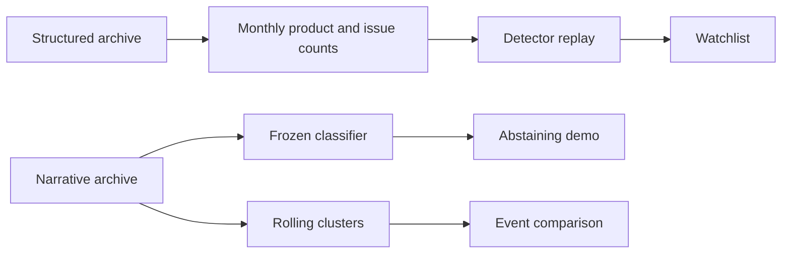

# Consumer Protection Intelligence

A [financial regulator analyst](docs/client_brief.md) uses the [watchlist](reports/watchlist.csv) to choose which changes in published complaint categories to investigate.

 · [Run the viewer or deploy it](docs/deployment.md) · [Released historical model](config/model_asset.json)

## Which detector earned its place?

The retained seasonal rule matched **2 of 15** public actions, with a median delay of 1 month among matches. The seasonal count model matched 1. EWMA matched more actions and generated more unmatched alerts. [Backtest and comparison criteria](reports/backtest.md) · [Synthetic spike results](reports/spike_power.csv)

## Did narratives give earlier warning?

The restricted mean advantage over the retained rule was **0.40 months**. The event-month bootstrap interval ranged from 0.00 to 0.78 months. Misses count at the end of the observation horizon. [Lead estimates](reports/lead_vs_retained.json) · [All events, including misses](reports/lead_vs_retained.csv) · [Cases](reports/case_studies.md)

## Can complaint text predict its recorded category?

On 1,354 held-out historical narratives, LinearSVC achieved **0.395 macro-F1** (95% interval 0.338 to 0.445). The constant predictor scored 0.046 (0.044 to 0.049). In this run the training and test majorities coincided. [Frozen experiment](reports/classifier_eval.md) · [Metrics and run commit](reports/metrics.json) · [Calibration](reports/reliability.png)

## Pipeline

[Structured code](scripts/detector.py) · [Classifier code](scripts/fresh_eval.py) · [Cluster code](scripts/clusters.py)

## Quickstart

Run `make demo` for the synthetic fixture and `make test` for the regression suite. For the viewer, install the [runtime lock](requirements.lock) in a Python 3.12 environment and run `make app`. [Make targets](Makefile) · [Deployment instructions](docs/deployment.md)

## Limitations

- Complaints reflect selective reporting. [Source assessment](docs/CFPB_SOURCE_ASSESSMENT.md)
- Taxonomy harmonization is partial. [Coverage audit](reports/taxonomy_coverage.csv)
- Announcements can follow incidents, and unmatched alerts lack independent adjudication. [Event register](docs/backtest_events.csv)
- Historical archive performance can drift. [Model card](docs/model_card.md)
- Revised monthly data cannot recreate all earlier publication vintages. [Technical report](docs/technical_report.md)

[Client brief](docs/client_brief.md) · [Classifier audit](EVALUATION_AUDIT.md) · [Backtest](reports/backtest.md) · [Remediation log](docs/remediation_log.md)
