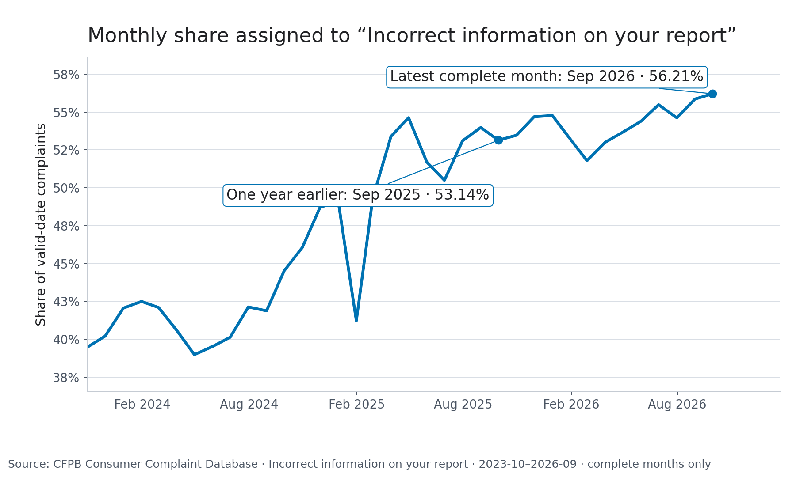

# Consumer Protection Intelligence

An evidence-led CFPB complaint case study.

## What changed in the complaint mix?

**September 2026:** `Incorrect information on your report` accounted for **371,428 of 660,839 valid-date complaints (56.21%)**. In September 2025, the same label accounted for **267,731 of 503,847 (53.14%)**, a **3.07 percentage-point increase**. These are full-source aggregates, not capped-sample counts; complete months satisfy the 15-day maturity rule.



- **View SQL:** [Year-over-year comparison](sql/year_over_year_issue_comparison.sql) · [Monthly trend view](sql/monthly_issue_trends.sql)
- **Read the report:** [Dated results and methods](reports/structured_trends.md)

The query matches the exact label and calendar months; each share uses all valid-date complaints in that month. This description is not causal or representative of all consumer experiences. See the [source assessment](docs/CFPB_SOURCE_ASSESSMENT.md) and [technical report](docs/technical_report.md).

No issue was flagged in September 2026. Screening requires 50 complaints and three prior observed same-calendar-month values, then flags increases of at least three sample standard deviations. Missing rows are not imputed as zero. A June flag involves non-harmonized investigation labels; details are in the report.

**Optional:** The historical narrative model uses archive exports, not current complaint text. See the [evaluation audit](EVALUATION_AUDIT.md) and [model card](docs/model_card.md).

## Local reproduction

Requires Python 3.10+ and internet access to retrieve CFPB's public structured archive (about 365 MB compressed at the reviewed URL).

```bash
python3 -m venv .venv
source .venv/bin/activate
make setup
make run
make report
make test
make app
```

`make run` scans the public structured archive and produces ignored local aggregates and manifests. `make report` reruns that pipeline and regenerates the aggregate-only report and chart under `reports/`. `make narrative-model` downloads selected official archive exports and rebuilds the historical model; it is not needed to reproduce the structured report and was not run for this review. `make app` binds Streamlit to `127.0.0.1:8501`. No dashboard deployment is configured.

## Repository map

- [`reports/`](reports/) - dated aggregate-only structured result and chart; no narrative text or complaint IDs
- [`sql/monthly_issue_trends.sql`](sql/monthly_issue_trends.sql) - SQL view for full-source counts and shares
- [`EVALUATION_AUDIT.md`](EVALUATION_AUDIT.md) - archived classifier evaluation, baselines, taxonomy shift, and caveats
- [`docs/`](docs/) - source, data, modeling, and interpretation methods
- [`docs/development/`](docs/development/) - handoff and interview preparation notes
- [`src/`](src/) and [`tests/`](tests/) - implementation and regression/unit tests

Raw exports, local samples, complaint text, generated manifests, databases, and trained model files are excluded from Git.
