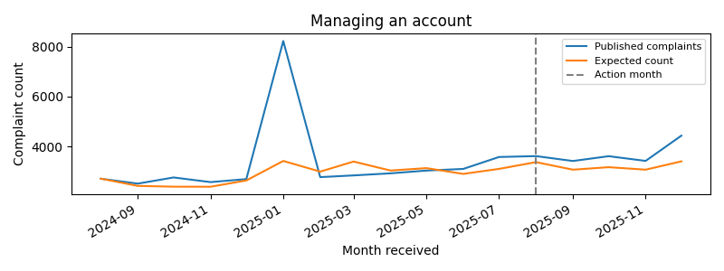
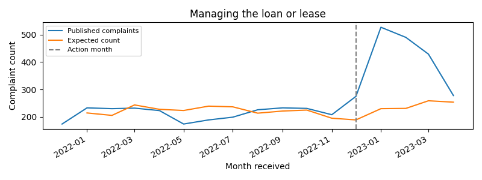

# Historical cases

Public action dates serve as reference points. A match means category and time overlap. It does not attribute complaints to a named firm.

## Checking or savings account | 2025-08-21

The CFPB filed a proceeding after the bankruptcy of Synapse, a provider connecting fintech platforms to banks. The bankruptcy preceded the filing, so the filing date can miss the original disruption. The [public action](https://www.consumerfinance.gov/enforcement/actions/synapse-financial-technologies-inc/) was mapped in advance to 'Managing an account'. The narrative method produced no matching alert. The product GLM produced no matching alert. Sample density, the available product history and the announcement date limit attribution. The data cannot identify the cause of any miss.

## Vehicle loan or lease | 2022-12-20

The Wells Fargo order covered auto-loan servicing, including incorrect payment application and fees. An industry-wide series pools many lenders and can obscure firm-specific changes. The [public action](https://www.consumerfinance.gov/enforcement/actions/wells-fargo-bank-na-2022/) was mapped in advance to 'Managing the loan or lease'. The narrative method produced no matching alert. The product GLM produced a match at month offset 2. Sample density, the available product history and the announcement date limit attribution. The data cannot identify the cause of any miss.

