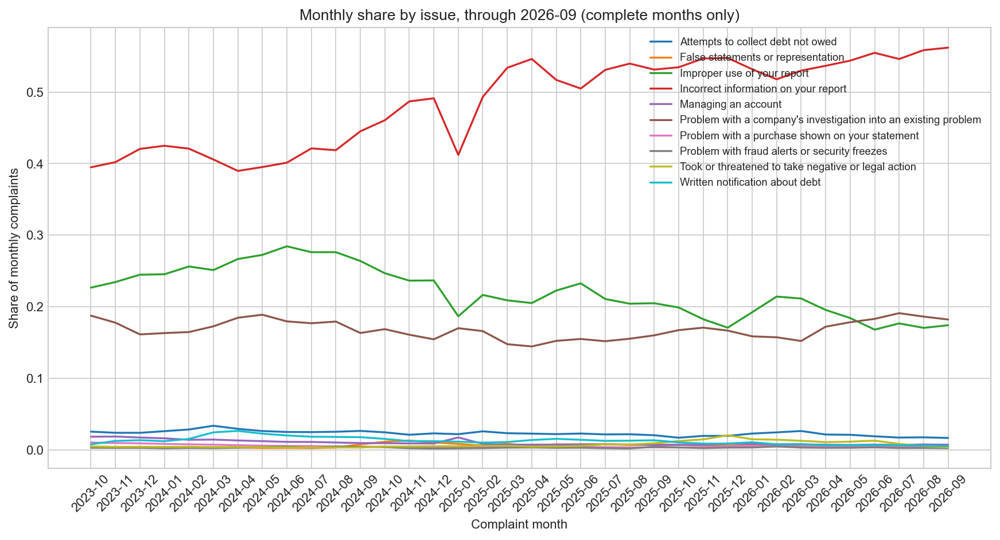

# CFPB structured complaint trends

**Snapshot received-date coverage through:** 2026-11-09 
**Retrieved:** 2026-11-10T03:55:55.012199+00:00 
**Latest complete complaint month under the maturity rule:** 2026-09

## What the trend shows

The chart below shows monthly shares for the ten highest-count issue labels over the latest 12 complete months, plotted across the latest 36 complete months. Counts and monthly denominators are full-source aggregates over valid complaint dates, not the capped local sample. Shares are each issue's count divided by all complaints with a valid received date in that calendar month.

The five largest issue counts across the latest 12 complete months were:

| Issue | Complaint count |
|---|---:|
| Incorrect information on your report | 3,808,603 |
| Improper use of your report | 1,303,621 |
| Problem with a company's investigation into an existing problem | 1,212,382 |
| Attempts to collect debt not owed | 140,627 |
| Took or threatened to take negative or legal action | 79,878 |

## Screening result for 2026-09

The existing exploratory screen requires at least 50 complaints and compares an issue's share with up to five prior **observed** months of the same calendar month. It requires at least three observations and flags a rise of at least three sample standard deviations. This is a prompt for investigation, not a significance test, incident finding, causal result, or evidence of consumer harm.

| Issue | Count | All complaints that month | Observed share | Mean comparison share | Historical months used |
|---|---:|---:|---:|---:|---|
| No issues met the screening rule in the latest complete month | | | | | |

The most recent earlier flag was **2026-06 — Problem with a company's investigation into an existing issue**: 922 of 620,905 complaints (0.1485%), versus a 0.0621% mean across 2021-06, 2022-06, 2023-06, 2024-06, 2025-06. The exact candidate label was observed in all five comparison months. Other investigation-labeled categories that month were counted separately: `Problem with a company's investigation into an existing problem` (113,635).

Missing issue-month rows are not zero-filled by the existing comparison; absent rows may reflect zero recorded counts, while changed category labels can split an issue across names. The comparison uses the latest five observed same-calendar-month rows, not necessarily five consecutive calendar years. Interpret any candidate in that light. The screen does not establish representativeness: CFPB complaint data are not a census of consumer experiences.

## Reproduction and method

Run `make run` to download/hash the public CFPB structured archive, scan full-source monthly counts and totals, apply the 15-day completeness rule, and write local aggregates. `make report` regenerates this report and chart from those outputs. The SQLite view is defined in [`sql/monthly_issue_trends.sql`](../sql/monthly_issue_trends.sql) and executed by [`src/cfpb_pipeline.py`](../src/cfpb_pipeline.py). The query divides full-source issue counts by full-source valid-date monthly totals; the 100,000-row sample is stored separately and is not the share denominator.

This report contains aggregate counts only. It does not contain complaint text or identifiers.
